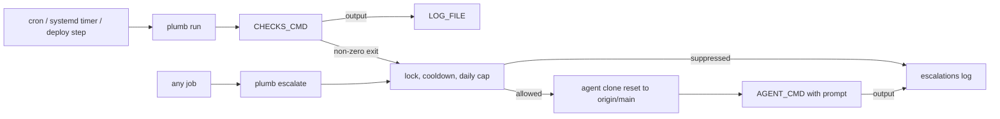

# Concepts

Plumb has two entry points and one shared mechanism. `plumb run` runs your
checks and escalates when they fail. `plumb escalate` lets any other job
escalate its own failure. Both go through the same escalator: a set of guards,
a clean agent clone, and a guardrailed prompt.



## Checks command

`CHECKS_CMD` is the one thing you write. It is a shell command that prints
evidence and exits non-zero when any hard check fails. Plumb runs it as
`bash -c 'set -uo pipefail; eval "$CHECKS_CMD"'`, with every variable from the
config file in its environment, and appends its stdout and stderr to
`LOG_FILE`. A command killed by a signal counts as a failure.

What counts as a hard check is up to you.
[`examples/checks-wrapper.sh`](../examples/checks-wrapper.sh) separates hard
checks, which set the failing exit code, from soft checks, which only print a
`WARN` line.

## Check runner

`plumb run` is the scheduled entry point. Each run:

1. Parses the optional `--context key=value` (see
   [Run context and deploy provenance](#run-context-and-deploy-provenance)).
2. Appends a header line, `=== <UTC timestamp> plumb checks`, to `LOG_FILE`,
   with ` context=<key>=<value>` added when a valid context was given.
3. Runs `CHECKS_CMD` and appends its output.
4. If the command exited non-zero, escalates under the context name `checks`,
   using `LOG_FILE` as the evidence.

Once the config has loaded and `LOG_FILE` is open, `plumb run` returns zero.
Suppressed escalations, agent failures, and escalation errors are all side
effects; none of them makes the run fail. This keeps the scheduler's view of
the job separate from the health of the deployment.

## Escalation

An escalation hands a failure to the maintenance agent. It takes a context
name and a log file. The context name identifies the failure mode for the
guards and appears in the prompt; `plumb run` always uses `checks`.

The escalator runs synchronously. When it is allowed through the guards it:

1. Records the cooldown stamp and increments the day's counter.
2. Prepares the [agent workspace](#agent-workspace).
3. Takes the last 4000 bytes of the log file as evidence (`log unavailable` if
   it cannot be read).
4. Builds the [prompt](#agent-prompt-and-guardrails) and runs `AGENT_CMD` with
   it, appending the agent's output to the escalations log.

## Escalation guards

Three guards run before any expensive work, in this order. A guard that stops
an escalation appends a `SUPPRESS` line to the escalations log and does not
call the agent:

```text
2026-07-18T07:15:00.000Z SUPPRESS checks (within 21600s cooldown)
```

### Per-context lock

Only one escalation per context name runs at a time. The lock is a file,
`lock-<context>`, created exclusively in the state directory and removed when
the escalation finishes. A second escalation for the same context while the
lock is held is suppressed as `already running`. Because a hard-killed process
cannot remove its lock, a lock older than the cooldown is treated as stale and
reclaimed.

### Cooldown

After an escalation for a context, later escalations for the same context are
suppressed for `PLUMB_ESCALATE_COOLDOWN_SECS` seconds (default `21600`, six
hours). The time of the last escalation is stored in `last-<context>`. Distinct
context names have independent cooldowns.

### Daily cap

At most `PLUMB_ESCALATE_DAILY_CAP` escalations (default `8`) run per day,
across all contexts. The count lives in `count-YYYYMMDD`, keyed by the
machine's local date, and counter files older than three days are deleted.

In file names, every character of the context that is not a letter or digit
becomes `_`.

## Agent workspace

The agent never works in the deployment checkout. Before each escalation,
plumb prepares `AGENT_WORKDIR`:

- If it has no `.git` directory, plumb clones `REPO_URL` into it.
- It runs `git fetch origin`, and if that succeeds,
  `git reset --hard origin/main`.

So the agent always starts from the repository's `main` branch, with any
leftovers from a previous escalation discarded. Plumb removes inherited
`GIT_DIR`, `GIT_WORK_TREE`, `GIT_INDEX_FILE`, `GIT_PREFIX`, and
`GIT_COMMON_DIR` from the environment of these git commands, so running plumb
from inside a git hook does not redirect them.

The agent itself runs as `bash -lc 'cd <AGENT_WORKDIR> && <AGENT_CMD> <prompt>'`,
with the prompt passed as one quoted final argument and the config's variables
in its environment. A non-zero exit from the agent is an error: `plumb escalate`
reports it and exits 1, while `plumb run` ignores it.

## Agent prompt and guardrails

The prompt tells the agent it is the on-call maintenance agent, names the
failed context, includes the log evidence, and asks it to read `CONTEXT_DOCS`
first (or "the repo docs" when that key is unset). It allows inspecting
services, containers, and logs, and read-only database queries. It then sets
these guardrails:

- Never modify or delete production data; only `SELECT` against databases.
- Never commit to `main`, force-push, or touch secrets files.
- For a confident code or config fix, push a branch named
  `auto/fix-<short-name>` and open a pull request, without merging it.
- For an uncertain or environmental cause, file an issue titled
  `[auto] <context> failing`, or comment on an existing open issue with that
  title.
- End with a one-paragraph summary.

These guardrails are instructions in the prompt. Plumb does not enforce them
after the agent runs; the separate clone is the only boundary it controls.

## Run context and deploy provenance

`plumb run --context key=value` attaches one context to a run. The key must
start with a letter and contain only letters, digits, `_`, and `-`; the value
must be non-empty and single-line. A malformed context prints
`plumb: ignoring malformed context ...` to stderr and the run continues
without it.

Any valid context tags the log header. For keys other than `deploy`, the
prompt also gets a `Run context: key=value.` line; the guards are unchanged.

The `deploy` key carries deploy provenance. Its value must be a 7 to 64 digit
hexadecimal Git SHA and is stored in lowercase. On every deploy run, before
the checks run, plumb reads the previous SHA from `deploy-sha` in the state
directory and writes the new one. If the checks then fail:

- The prompt says the failure began right after this deploy.
- When a different previous SHA was recorded and both commits exist in the
  agent clone, the prompt includes the range `<previous>..<sha>` and its
  `git diff --stat`. If either commit cannot be found, it names the range
  without a diff. With no previous SHA, it says no range is available.
- The cooldown is keyed to the deploy SHA, so a new deploy can escalate even
  inside the cooldown of an earlier failure. The lock is still shared with
  plain `checks` runs, and the daily cap still applies.
- The plain `checks` cooldown stamp is also updated, so a following run
  without a deploy context does not immediately escalate again.

`deploy-sha` holds only the latest SHA. It is not a history of deploys.

## State and logs

Plumb keeps everything beside `LOG_FILE` unless you move it:

- `LOG_FILE` gets every run's header and checks output.
- The escalations log, whose name is `LOG_FILE` with a trailing `.log`
  replaced by `-escalations.log`, gets agent output and `SUPPRESS` lines.
  Escalations from `plumb escalate` write here too, whatever log file they
  were given as evidence.
- The state directory, `PLUMB_STATE_DIR` or a `state` directory beside
  `LOG_FILE`, holds the lock, cooldown, counter, and `deploy-sha` files.

Timestamps that plumb writes are UTC ISO 8601 strings ending in `Z`.
